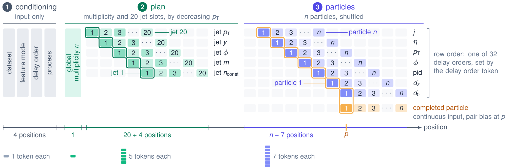
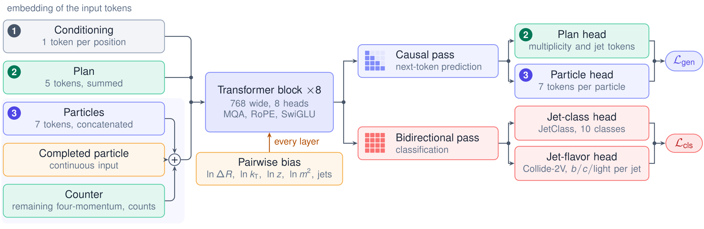

# OmniX: A first jet and event model

<div align="center">

Anna Hallin, Gregor Kasieczka, Henning Rose

[](https://arxiv.org/abs/2611.31403)
[](https://pytorch.org)
[](https://lightning.ai)
[](https://hydra.cc)

</div>

**Abstract**:

> Foundation models are a new approach to building machine learning algorithms for particle physics. Their central idea is that a single model can be adapted to a variety of downstream tasks, amortizing training costs. So far, most foundation model prototypes have operated on the constituents of a single jet. This limits their usefulness for physics problems at the scale of full events, such as distinguishing different processes, and restricts their performance, as global correlations are invisible to the model. Here, we introduce OmniX, an architecture that operates on both single jets and whole events within a single model. Using the jet-level JetClass and Top-tagging datasets and the event-level Collide-2V dataset, we demonstrate that OmniX trained jointly on single jets and full events matches or exceeds otherwise equivalent jet-only and event-only models in generation and classification.

OmniX is one autoregressive transformer that generates and classifies both single jets and full collision events with one token design. This repository holds
the three models of the paper, the code to sample from them and to use them as classifiers, and
the code to train them.



**The sequence.** Every jet or event becomes one sequence: four conditioning tokens, a plan
with the particle multiplicity and up to twenty jets, then the particles with seven features
each, staggered along the diagonal in one of 32 delay orders. The sequence is built in
[`humite/data/`](humite/data/): [`readers.py`](humite/data/readers.py) reads the datasets,
[`codec.py`](humite/data/codec.py) bins the features into tokens, and
[`tokenizer.py`](humite/data/tokenizer.py) assembles the conditioning, the plan and the delayed
particle features. The bins and the token layout are set in
[`humite/config/dataset/tokens.yaml`](humite/config/dataset/tokens.yaml).



**The network.** One transformer runs twice per training step, once causally to
generate and once bidirectionally to classify. The model is in
[`humite/models/`](humite/models/): [`omnix.py`](humite/models/omnix.py) embeds the inputs on
the left of the figure (tokens, completed particles, counter) and runs both passes,
[`transformer.py`](humite/models/transformer.py) holds the transformer blocks and
[`pairwise_bias.py`](humite/models/pairwise_bias.py) the pairwise bias. The heads on the right
are in [`plan.py`](humite/models/plan.py) (plan), [`heads.py`](humite/models/heads.py)
(particle tokens), [`read_head.py`](humite/models/read_head.py) (jet class) and
[`jet_decoder.py`](humite/models/jet_decoder.py) (jet flavour). The two losses are combined in
[`lightning_module.py`](humite/models/lightning_module.py), and sampling happens in
[`generation.py`](humite/models/generation.py).

| model       | training set          | parameters | config                    |
| ----------- | --------------------- | ---------- | ------------------------- |
| **OmniX**   | JetClass + COLLIDE-2V | 144 M      | `+experiment=omnix`       |
| jets-only   | JetClass              | 107 M      | `+experiment=jets_only`   |
| events-only | COLLIDE-2V            | 125 M      | `+experiment=events_only` |

## Installation

```sh
git clone https://github.com/uhh-pd-ml/OmniX && cd OmniX
pip install -e .        # Python >= 3.10
```

The image [`henningrose/omnix:1.0.0`](https://hub.docker.com/r/henningrose/omnix/tags) is the
environment the paper's models were trained in (Python 3.12, PyTorch 2.10.0, CUDA 12.6). It
holds the dependencies only, so the code is installed inside it:

```sh
# Docker
docker run --gpus all -it --rm -v "$PWD":/workspace henningrose/omnix:1.0.0 bash
pip install --no-deps -e .

# Apptainer / Singularity
apptainer pull omnix-1.0.0.sif docker://henningrose/omnix:1.0.0
apptainer shell --nv omnix-1.0.0.sif
pip install --no-deps -e . && export PATH="$HOME/.local/bin:$PATH"
```

[`docker/`](docker/) builds an image with the same package versions from scratch.

## Pretrained models

```sh
./checkpoints/download_checkpoints.sh
```

downloads `checkpoints/{omnix,jets_only,events_only}/`, each with `config.yaml` and
`model.ckpt`.

```python
from humite.pretrained import load_pretrained

module, data = load_pretrained("checkpoints/omnix")
```

## Generation

```sh
# 10,000 JetClass jets, jet type not given
python scripts/generate.py checkpoints/omnix jets --n 10000 --out jets.npz
# top jets
python scripts/generate.py checkpoints/omnix jets --condition TTBar --n 10000 --out top_jets.npz
# COLLIDE-2V events of one process
python scripts/generate.py checkpoints/omnix events --condition QCD_HT50toInf --n 10000 --out qcd.npz
```

The script uses the sampling settings of the paper's figures: temperature 1 without top-k or
top-p, and for events the out-of-jet exclusion with R = 0.4.
[`examples/generate.ipynb`](examples/generate.ipynb) does the same step by step and plots a few
distributions.

## Classification

The models tag while they are trained to generate: OmniX and the jets-only model give the
JetClass jet type, OmniX and the events-only model the flavour (b, c, light) of every jet of a
COLLIDE-2V event.

```sh
python scripts/classify.py checkpoints/omnix jetclass --n 100000
python scripts/classify.py checkpoints/omnix collide2v --n 20000
```

This needs the converted datasets (next section).

## Data

The loaders read parquet files written by the converters in [`scripts/data/`](scripts/data/):
`convert_jetclass.py` followed by `interleave_jetclass.py` for
[JetClass](https://zenodo.org/records/6619768), and `convert_c2v_fullevent.py` for COLLIDE-2V,
which is available on request from its authors.
The directories are read from the environment; a `.env` file in the working directory is picked
up automatically:

```sh
HUMITE_JETCLASS_DIR="<converted JetClass>/"          # train_100M/ val_5M/ test_20M/
HUMITE_C2V_FULLEVENT_DIR="<converted COLLIDE-2V>/"   # train/ val/ test/
HUMITE_OUTPUT_DIR="<directory for training runs>"    # defaults to ./outputs
```

## Training

Every model is trained in two stages with the same experiment config. The trunk runs at a
constant learning rate and is stopped by hand at the validation plateau. The anneal resumes the
plateau checkpoint and decays the learning rate with a cosine to the final step, about 20 % later. The
paper's runs used 8 GPUs with 128 events per GPU and step.

| experiment    | plateau step | final step |
| ------------- | ------------ | ---------- |
| `omnix`       | 1,376,256    | 1,654,784  |
| `jets_only`   | 974,848      | 1,171,456  |
| `events_only` | 466,944      | 565,248    |

```sh
# trunk
humite-train +experiment=omnix trainer.devices=8 trainer.strategy=ddp

# anneal
humite-train +experiment=omnix trainer.devices=8 trainer.strategy=ddp \
    resume_ckpt_path=<trunk run>/checkpoints/step_step=1376256.ckpt \
    model.schedule.decay_start=1376256 model.schedule.total_steps=1654784 \
    trainer.max_steps=1654784

# short test on one GPU
humite-train +experiment=omnix trainer.max_steps=62 trainer.val_check_interval=62 \
    trainer.limit_val_batches=9 data.num_workers=2 model.compile=false
```

Runs are logged to CSV files in the run directory; `logger=comet` logs to Comet instead.
[`examples/train_slurm.sh`](examples/train_slurm.sh) is a SLURM job script for both stages.

## Repository structure

```
humite/
├── config/          # Hydra configs: dataset/ (token design, training sets), model/, experiment/
├── data/            # readers, tokenizer, event streams
├── models/          # the transformer, the OmniX model, sampling, the training module
└── cli/train.py     # humite-train
scripts/
├── generate.py      # sample jets or events from a model
├── classify.py      # tagging metrics of a model on the test sets
└── data/            # dataset converters
assets/              # figures of this README
checkpoints/         # download script for the released models
examples/            # notebook and job script
tests/
```

## Citation

If you use this code or the models, please cite:

```bibtex
@misc{Hallin:2026omnix,
    author = "Hallin, Anna and Kasieczka, Gregor and Rose, Henning",
    title = "{OmniX: A first jet and event model}",
    eprint = "2611.31403",
    archivePrefix = "arXiv",
    primaryClass = "hep-ph",
    month = "11",
    year = "2026"
}
```
